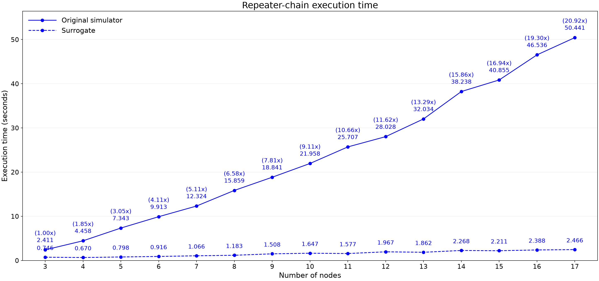
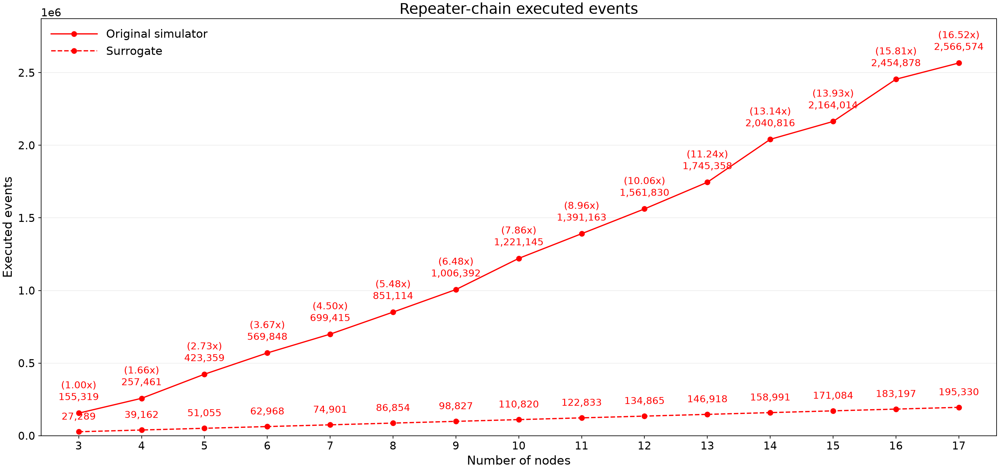
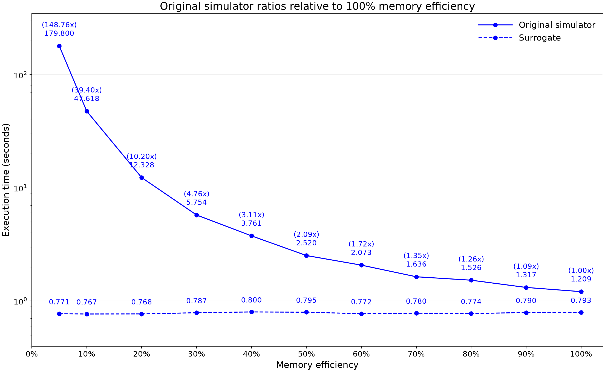
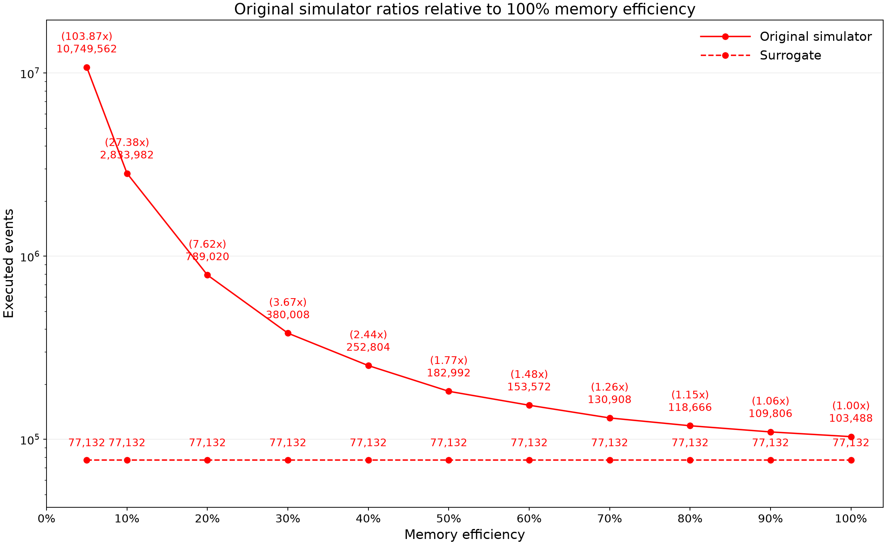

# Artificial Intelligence–Native Quantum Network Simulation

Detailed quantum network simulations track individual attempts to establish entanglement, which makes it computationally expensive to compare many network designs. The Artificial Intelligence–Native Quantum Network Simulation LDRD project developed two surrogate models to accelerate this work. For repeater chains, we trained a transformer on SeQUeNCe simulation data and used a mixture density network to jointly sample the time to deliver end-to-end entanglement and its fidelity, a measure of how closely the delivered state matches the ideal state. Across configurations spanning 3 to 17 nodes, the median Kolmogorov–Smirnov statistics comparing the predicted and simulated distributions were 0.035 for delivery time and 0.036 for fidelity. In a 17-node benchmark, surrogate-assisted entanglement generation simulation reduced wall-clock runtime from 50.44 to 2.47 seconds, a 20-fold speedup. For individual links, we integrated an analytical model into Argonne’s SeQUeNCe simulator that samples the time to successful entanglement directly, skipping individual failed attempts. At 5% memory efficiency, the single-link benchmark ran in 0.77 seconds, down from 179.80 seconds, a 233-fold speedup. These capabilities make it practical to screen more quantum network designs and operating conditions before running detailed simulations on the most promising candidates.

## Repeater-chain benchmarks

## Single-link benchmarks

